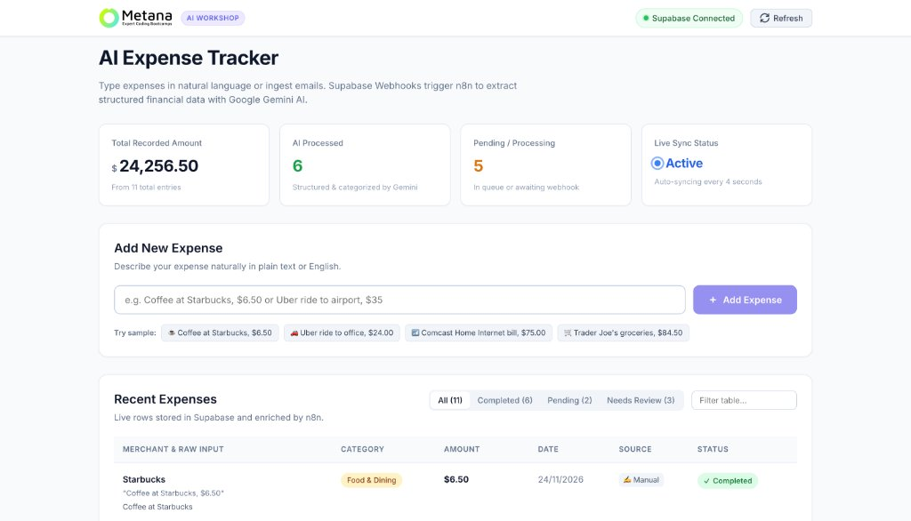

<p align="center">
  <a href="https://metana.io" target="_blank" rel="noopener noreferrer">
    
  </a>
</p>

<h1 align="center">How To Build Your Own AI Agent</h1>

<p align="center">
  <strong>Metana Workshop Setup Guide: Autonomous AI Expense Tracker</strong>
</p>

<p align="center">
  
  
  
  
  
</p>

---

Welcome to the Metana workshop: **How To Build Your Own AI Agent**! In this hands-on workshop, you will build an autonomous, AI-powered expense tracking agent by connecting a modern **React frontend** to **Supabase**, **n8n**, and **Google Gemini AI**.

<p align="center">
  
</p>

---

## Architecture Overview

```text
MANUAL EXPENSE FLOW
===================
1. User types expense ("Coffee at Starbucks, $6.50")
          │
          ▼
   [ React Frontend ]
          │  (Supabase JS Client - INSERT row)
          ▼
   [ Supabase DB: public.expenses ]  ── status: "pending"
          │
          │  (Database Webhook fires on INSERT)
          ▼
   [ n8n Automation Engine ]
          │
          │  (Sends raw text + schema prompt)
          ▼
   [ Google Gemini AI ]
          │
          │  (Returns structured JSON: merchant, amount, category, date)
          ▼
   [ n8n Parser & Supabase Node ]
          │
          │  (Updates existing row matching `id`)
          ▼
   [ Supabase DB: public.expenses ]  ── status: "completed"
          │
          │  (Frontend polls or auto-refreshes every 4s)
          ▼
   [ React Frontend ]  ── Displays parsed merchant, category & formatted amount!


EMAIL RECEIPT FLOW (OPTIONAL)
=============================
   [ Gmail Inbox ]
          │
          ▼
   [ n8n Gmail Trigger ]
          │
          ▼
   [ Supabase: Create Expense Row ] (source: "email", status: "pending")
          │
          ▼  (Fires the same Supabase INSERT Webhook above!)
   [ Same n8n AI Processing Flow ]
```

---

##  Prerequisites & Accounts Needed

Before starting, make sure you have:

1. **Node.js (v18+)** installed: [nodejs.org](https://nodejs.org/)
2. **Supabase Account**: [supabase.com](https://supabase.com/)
3. **n8n Account**: [n8n.io](https://n8n.io/) (n8n Cloud or self-hosted)
4. **Google AI Studio Account**: [aistudio.google.com](https://aistudio.google.com/) (for free Gemini API access)
5. **(Optional) Gmail Account**: If you want to enable automatic email receipt ingestion.

> [!IMPORTANT]
> Each participant must use their **own credentials**. Never share or commit secret keys.

---

## Quick Start: Set Up the Frontend

### 1. Clone & Install Dependencies

Open your terminal in the project directory:

```bash
# Install dependencies
npm install

# Ensure Supabase client library is installed
npm install @supabase/supabase-js
```

### 2. Configure Environment Variables

Copy `.env.example` to create your local `.env` file:

```bash
cp .env.example .env
```

Open `.env` in VS Code or your text editor:

```env
VITE_SUPABASE_URL=https://YOUR_PROJECT_REF.supabase.co
VITE_SUPABASE_ANON_KEY=YOUR_SUPABASE_PUBLISHABLE_KEY
```

*(You will fill in these values in Step 1 below).*

### 3. Start the Development Server

```bash
npm run dev
```

Open [http://localhost:5173](http://localhost:5173) in your browser.

---

